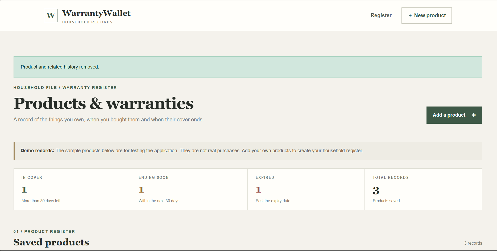

# WarrantyWallet

A household warranty register built with **Java 21** and **Spring Boot**. Keep product details, purchase receipts, warranty dates, and repair history together in one place.

## Deployment

**Deployment target:** Render (Docker web service)  
**Database:** Neon PostgreSQL  
**Build:** Dockerfile using Maven and Eclipse Temurin 21

The Render Docker deployment has completed successfully and the application is configured to connect to Neon PostgreSQL through environment variables.

The Render free instance used for this deployment may spin down after inactivity. As Render notes in the service dashboard, the first request after an idle period can be delayed by 50 seconds or more.

> **Receipt storage note:** Product and repair records are stored in Neon PostgreSQL. Receipt files are saved on the application's local filesystem using `UPLOAD_DIR`. The current free Render instance does not provide durable local file storage, so uploaded receipts may be lost when the service restarts or is redeployed. Use a Render persistent disk or object storage such as Amazon S3 before relying on receipt uploads in production.

## Dashboard



The dashboard groups saved products by warranty status so it is easy to see what is covered, what is nearing expiry, and what has expired.

## Features

- **Product register:** Save a product's name, category, brand, purchase date, warranty duration, serial number, seller, and notes.
- **Automatic expiry dates:** Calculate the warranty end date from the purchase date and warranty duration.
- **Status dashboard:** View products that are in cover, ending within 30 days, or expired.
- **Receipt attachments:** Upload PDF, JPG, or PNG purchase receipts (maximum 8 MB per file).
- **Product records:** Open a product detail page to review its saved information and receipt.
- **Repair history:** Record service dates, service centres, repair details, and costs.
- **In-app reminders:** A daily scheduled task creates reminders for warranties expiring within 30 days and products that expired within the previous 7 days.
- **Related-record cleanup:** Deleting a product also removes its associated repair and reminder records.
- **Database options:** Use H2 for local development and Neon PostgreSQL for the hosted deployment.

## Technology stack

| Area | Technology |
|---|---|
| Language | Java 21 |
| Application framework | Spring Boot 3.5.7 |
| Web layer | Spring MVC, Thymeleaf |
| Persistence | Spring Data JPA, Hibernate |
| Databases | H2 (local), Neon PostgreSQL (hosted) |
| Validation | Jakarta Bean Validation |
| Scheduled tasks | Spring Scheduler |
| Tests | JUnit 5 |
| Build | Maven |
| Containerisation | Docker |

## Run locally

### Prerequisites

- JDK 21
- Maven 3.9 or later

### Windows

1. Clone the repository:

   ```bash
   git clone https://github.com/codewithsayan7/WarrantyWallet.git
   ```

2. Open the project folder that contains `pom.xml` in VS Code.
3. Start the application:

   ```bash
   mvn org.springframework.boot:spring-boot-maven-plugin:3.5.7:run
   ```

4. Open [http://localhost:8080](http://localhost:8080).

You can also use the included `RUN-WINDOWS.bat` file from the project root.

By default, local development uses a file-based H2 database saved as `warrantywalletdb.mv.db`.

## Environment configuration

The hosted service reads configuration from environment variables. Set these in the Render service dashboard, not in source code:

| Variable | Purpose |
|---|---|
| `DB_URL` | JDBC URL for Neon PostgreSQL, including SSL options |
| `DB_USERNAME` | Neon database role |
| `DB_PASSWORD` | Neon database password |
| `DB_DRIVER` | `org.postgresql.Driver` |
| `PORT` | Port supplied/configured by the hosting platform |
| `UPLOAD_DIR` | Directory used to store uploaded receipts |
| `REMINDERS_ENABLED` | Enables or disables scheduled in-app reminders |

Never commit database passwords, connection strings containing credentials, or `.env` files.

## Local data and uploaded receipts

- The local H2 database is stored in `warrantywalletdb.mv.db`.
- Uploaded receipts are stored under `uploads/receipts/` by default.
- These are runtime data and are excluded from Git by `.gitignore`.

Back up the local database and receipt directory before deleting or moving the local project folder.

## Scheduled reminder behaviour

The scheduler runs every day at **8:00 AM in the server's local timezone**. It creates one in-app reminder per product per day when a warranty is due to expire within the next 30 days or expired within the previous 7 days.

Reminders are displayed inside the application. **Email, SMS, and push notifications are not implemented.** A missed scheduled run is not replayed automatically.

## Tests

Run the test suite with:

```bash
mvn test
```

## Implementation topics

Areas of the codebase worth exploring:

- Warranty expiry-date calculations using `LocalDate`.
- JPA entities and repository relationships for products, repairs, and reminders.
- Form validation and receipt upload handling.
- Safe receipt filename generation and protected file retrieval.
- Scheduled reminder generation and duplicate prevention.
- H2 local development versus Neon PostgreSQL deployment configuration.

## Planned improvements

These are possible future enhancements, not current features:

- User accounts and household-level ownership.
- Durable receipt storage using a Render persistent disk or S3-compatible object storage.
- Email or push notifications.
- Reminder retry and delivery status.
- Audit history and expanded integration tests.

## Project structure

```text
WarrantyWallet/
├── src/
│   ├── main/
│   │   ├── java/              # Controllers, entities, services and repositories
│   │   └── resources/
│   │       ├── static/        # CSS and static assets
│   │       └── templates/     # Thymeleaf pages
│   └── test/                  # Automated tests
├── docs/
│   └── images/                # README screenshots
├── Dockerfile
├── pom.xml
└── README.md
```

## License

No license has been added yet. Contact the repository owner before reusing or distributing this project.
